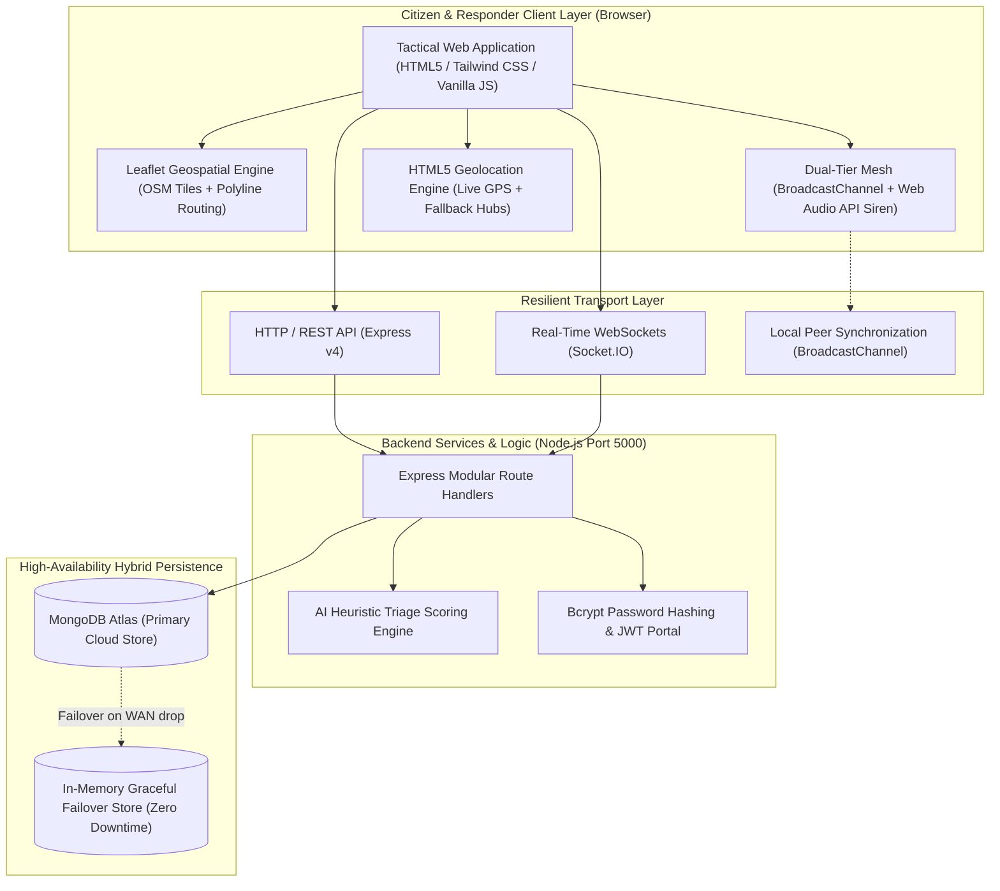

<div align="center">

# 🚨 Sahayta 2.0 (सहायता 2.0)
### Next-Gen Decentralized, Edge-Resilient & Hyperlocal Crisis Response Platform

[](https://opensource.org/licenses/MIT)
[](https://nodejs.org/)
[](https://expressjs.com/)
[](https://leafletjs.com/)
[](https://socket.io/)
[](#-full-bilingual-support)
[](#-theme-engine)
[](#-offline-mesh-network)

<p align="center">
  <b>Saving lives during natural calamities through real-time AI triage, offline P2P mesh resiliency, live GPS nearest-facility routing, and multi-tier community trust verification.</b>
</p>

[✨ Key Highlights](#-major-core-features--innovations) • [📱 Platform Modules](#-platform-modules--interface-showcase) • [🏗️ System Architecture](#️-system-architecture) • [📊 Feature Matrix](#-feature-comparison-matrix) • [🚀 Quick Start](#-quick-start-guide) • [📡 API Reference](#-api-endpoints) • [👥 Authors & Contributors](#-authors--lead-contributors)

---

</div>

## 🌟 Major Core Features & Innovations

### 1. 🏥 Operational Nearest Resource Engine & Polyline Routing
* **Instant Multi-Category Discovery**: Intelligently locates the nearest:
  * 🏥 **Trauma Centers & Hospitals** (ICU availability, emergency beds)
  * ⛺ **Emergency Shelters & Relief Camps** (Capacity & intake status)
  * 🍲 **Community Langar & Food Hubs** (Meal availability & water tankers)
  * 🚓 **Police & First Responder Units** (Direct emergency dispatch)
  * 🩸 **Blood Banks & Oxygen Depots** (Real-time O-, A+, B+ units)
  * 🤝 **NGO Relief Fleets** (Water rescue boats, 4x4 convoys)
* **Real-Time Polyline Routing**: Dynamically renders high-visibility navigational paths between user coordinates and relief points with real-time ETA estimates.
* **1-Click Google Turn-by-Turn GPS**: Native integration launching turn-by-turn driving directions with one tap.

---

### 2. 📡 Zero-Internet Dual-Tier Mesh Network & Acoustic SOS Siren
* **Dual-Tier Resilient Messaging**:
  * **Online Tier**: Low-latency WebSocket broadcasting via Socket.IO.
  * **Offline Mesh Tier**: Automatic failover to HTML5 `BroadcastChannel` & WebRTC Data Channels for local, peer-to-peer inter-device synchronization without cellular infrastructure.
* **Web Audio API Morse SOS Acoustic Beacon**: Synthesizes a high-decibel acoustic emergency alarm (`... --- ...`) directly through hardware speakers to guide search-and-rescue teams in zero-visibility scenarios.
* **SMS Distress Fallback**: Automatically formats GPS distress text messages to National Disaster Response helplines (`112` / `1077`).

---

### 3. 🌐 Full Indic Multilingual Support (English, हिंदी & বাংলা)
* Instant, persistent client-side localization across all interface elements, map tooltips, triage feeds, and modals.
* Preference saved seamlessly in `localStorage` with reactive updates across active views.

---

### 4. 🆘 Algorithmic AI Triage Scoring Engine
* Real-time heuristic severity index (0–100):
  * 🔴 **Critical Priority (90–100)**: Structural collapse, submerged individuals, infant/medical emergencies.
  * 🟠 **High Priority (70–89)**: Elderly stranded, oxygen shortages, rising floodwaters.
  * 🟡 **Medium Priority (40–69)**: Supply shortages, impassable roads.
* Multi-tier trust badges: `UNVERIFIED` ➔ `COMMUNITY VERIFIED` ➔ `NGO VERIFIED` ➔ `AUTHORITY VERIFIED`.

---

### 5. 🌓 High-Contrast Dark & Light Mode Theme Engine
* Engineered with WCAG accessibility guidelines for daylight glare and night rescue missions.
* Instant variable toggle switching between crisp light slate and deep night tactical contrast.

---

## 📱 Platform Modules & Interface Showcase

| Module | Primary Interface | Key Capabilities | Status |
| :--- | :--- | :--- | :---: |
| **Tactical Crisis Map** | [`live_crisis_intelligence_map.html`](./live_crisis_intelligence_map.html) | Leaflet GIS map, layer toggles, nearest shelter routing, live GPS tracking | ✅ **Active** |
| **Command Dashboard** | [`crisis_dashboard_homepage.html`](./crisis_dashboard_homepage.html) | Live casualty metrics, facility statuses, quick links, active advisories | ✅ **Active** |
| **Emergency SOS Hub** | [`sos_emergency_activation.html`](./sos_emergency_activation.html) | One-touch panic distress, dual-tier mesh chat, AI triage calculation | ✅ **Active** |
| **Resource Directory** | [`resource_directory_locator.html`](./resource_directory_locator.html) | Distance-sorted shelters, hospitals, food relief, availability status | ✅ **Active** |
| **Offline Mesh Network** | [`offline_mesh_network.html`](./offline_mesh_network.html) | Web Audio Morse siren, peer-to-peer broadcast synchronization | ✅ **Active** |
| **Preparedness Academy**| [`emergency_prepared_academy.html`](./emergency_prepared_academy.html) | Disaster survival guides (Flood, Earthquake, Cyclone, Fire safety) | ✅ **Active** |
| **Verification Centre** | [`communication_verification_centre.html`](./communication_verification_centre.html)| Fact-checking rumor radar, community crowdsourced verification | 🟡 **Prototype**|

---

## 🏗️ System Architecture



---

## 📊 Feature Comparison Matrix

| Feature / Capability | Traditional Emergency Apps | **Sahayta 2.0 (सहायता 2.0)** |
| :--- | :---: | :---: |
| **Operation Without Internet** | ❌ Fails completely | ✅ **Dual-Tier Mesh & Web Audio Acoustic SOS** |
| **Dynamic Nearest Facility Routing** | ⚠️ Static address list only | ✅ **Real-Time GPS Polyline Route & Distance** |
| **Database Failure Resilience** | ❌ App crashes on DB error | ✅ **Automated In-Memory Failover Layer** |
| **Indic Multilingual Localization**| ❌ English only | ✅ **One-Tap English & Hindi Localization** |
| **Emergency Triage Prioritization** | ❌ First-come first-served | ✅ **Algorithmic AI Severity Indexing (0–100)**|
| **Tactical Dark Mode for Night Ops**| ⚠️ Generic inverted theme | ✅ **High-Contrast High-Legibility Visual Tokens**|

---

## ⚡ Quick Start Guide

### Option 1: One-Click Windows Launch
Double-click **`START_SAHAYTA.bat`** in the repository root:
1. Automatically verifies dependencies and Node.js runtime.
2. Boots the Express backend server on port `5000`.
3. Opens `http://localhost:5000` in your default browser.

---

### Option 2: Cross-Platform Manual Setup (Linux / macOS / Windows)

```bash
# 1. Clone the repository
git clone https://github.com/Aadityasingh08/Sahayta-2.0.git
cd Sahayta-2.0

# 2. Install dependencies
npm install

# 3. Start the application
node server.js
```

Open your browser and navigate to: **`http://localhost:5000`**

---

## 🌐 API Endpoints

| Method | Endpoint | Description | Status |
| :---: | :--- | :--- | :---: |
| `GET` | `/api/db-check` | Database health monitor & active failover mode check | 🟢 Verified |
| `POST` | `/api/auth/signup` | Register new responder account (Bcrypt encrypted) | 🟢 Verified |
| `POST` | `/api/auth/login` | Authenticate user and issue secure JWT session token | 🟢 Verified |
| `GET` | `/api/resources` | Fetch all relief shelters, hospitals, and supply depots | 🟢 Verified |
| `POST` | `/api/resources` | Register a verified emergency relief center | 🟢 Verified |
| `GET` | `/api/sos` | Retrieve real-time emergency distress queue | 🟢 Verified |
| `POST` | `/api/sos` | Dispatch emergency SOS alert with automated AI triage | 🟢 Verified |
| `GET` | `/api/location` | Fetch active user geolocation coordinates | 🟢 Verified |
| `POST` | `/api/location/save` | Upsert and synchronize user GPS coordinates | 🟢 Verified |
| `GET` | `/api/alerts` | Stream verified disaster warning advisories | 🟢 Verified |
| `POST` | `/api/alerts` | Broadcast high-priority alert to connected clients | 🟢 Verified |

---

## 👥 Authors & Lead Contributors

<div align="center">

<table>
  <tr>
    <td align="center" width="50%">
      <a href="https://github.com/Aadityasingh08">
        <br />
        <br />
        <b>Aditya Singh</b>
      </a>
      <br />
      <sub>Lead Architect & Full-Stack Systems Engineer</sub>
      <br /><br />
      <a href="https://github.com/Aadityasingh08">
        
      </a>
      &nbsp;
      <a href="https://www.linkedin.com/in/aditya-singh-392b9934b/">
        
      </a>
    </td>
    <td align="center" width="50%">
      <a href="https://github.com/BhawnaBhadana?tab=repositories">
        <br />
        <br />
        <b>Bhawna Bhadana</b>
      </a>
      <br />
      <sub>Core Contributor & UI/UX Frontend Specialist</sub>
      <br /><br />
      <a href="https://github.com/BhawnaBhadana?tab=repositories">
        
      </a>
      &nbsp;
      <a href="https://github.com/BhawnaBhadana?tab=repositories">
        
      </a>
    </td>
  </tr>
</table>

<br />

**Special Acknowledgements:**
- 🤖 **Antigravity (Google DeepMind)** — Autonomous AI Engineering & Pair Programming Agent
- 🌍 **OpenStreetMap & Leaflet Community** — Humanitarian geospatial mapping infrastructure

</div>

---

## 🛡️ License

This project is licensed under the **MIT License** — free and open-source for humanitarian disaster response, research, and community resilience.
